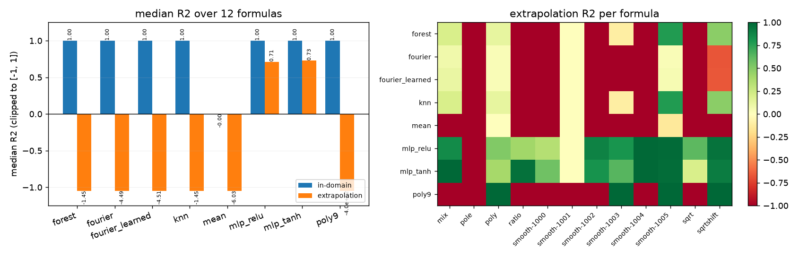
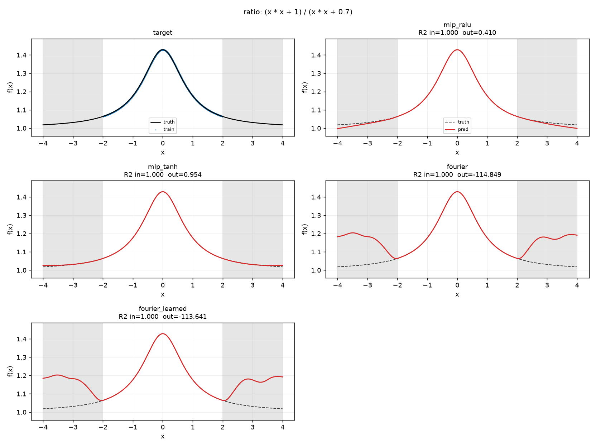
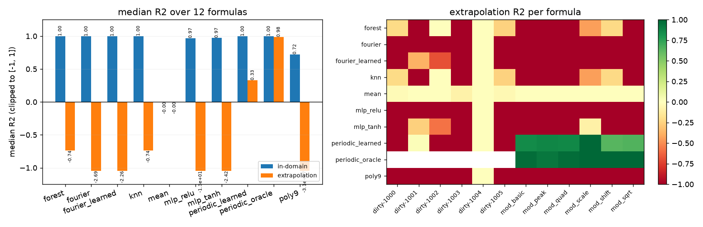
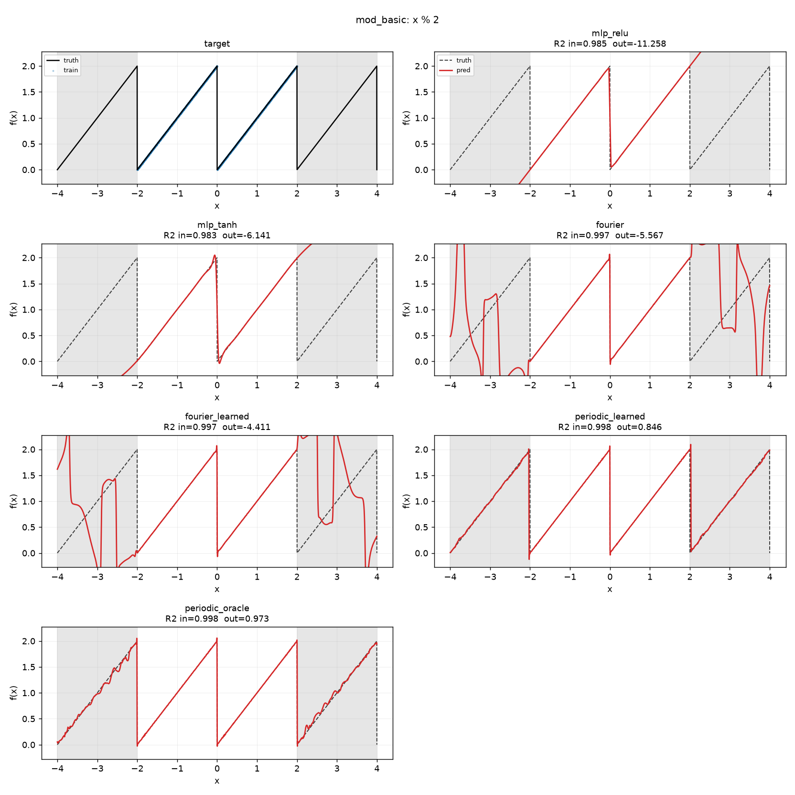
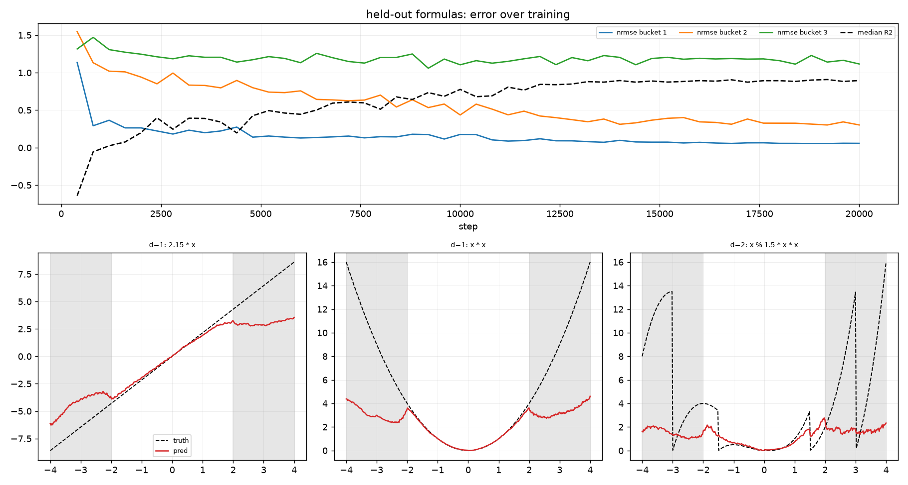

# arith_net

随机抽一个含四则运算、取模、开方的算式，让神经网络去学它 —— 然后诚实地测它到底学到了什么。

核心问题不是"能不能拟合"，而是下面三个更尖锐的问题：

1. **域内拟合谁都能做到** —— MLP、kNN、随机森林都能在训练区间内做到 R²=1.0。
2. **外推才是真相** —— 训练区间 `|x| ≤ 2`，测试区间 `2 < |x| ≤ 4`。
   真正的区别全在外推上。
3. **先验能不能被"喂"进去** —— `x % 3` 是锯齿波。给网络原始输入，
   它就学不会；给它周期性的正弦特征，它立刻学会。这个对比是本项目的重点。

三个实验、一句话结论：

| 实验 | 问题 | 结论 |
|---|---|---|
| E1 | 单个平滑公式能不能学会 | 域内全部 R²=1.0；外推只有 tanh-MLP 勉强（+0.73），kNN/森林 −1.45，多项式 −400 |
| E2 | 加一个 `%` 会怎样 | 所有通用模型外推 R² < 0；给"周期"这个先验后跳到 **+0.86**（给真实周期 +0.98） |
| E3 | 一个网络能不能学会求值**任意**公式 | 深度 1：93% 的留出公式 R²>0.9；深度 3 失败；`%` 仍是分水岭（0.986 vs 0.177） |

## 环境

PyTorch (CUDA) + matplotlib，使用 [uv](https://docs.astral.sh/uv/) 管理。

| 组件 | 版本 |
|---|---|
| Python | 3.13.14 (uv 托管) |
| torch | 2.14.1+cu130 (CUDA 13.0, RTX 4060 Laptop / sm_89) |
| matplotlib | 3.11.2 |
| scikit-learn | 1.9.1（E1/E2 的基线模型） |

```powershell
uv sync                      # 按 uv.lock 还原环境
uv run python check_env.py   # 环境自检（GPU 可用性 + 小矩阵乘 + 绘图）
```

## 任务定义（必须写死，否则结果不可比）

- **取模用 floor 语义**（`numpy.mod`）：`m > 0` 时 `x % m ∈ [0, m)`，
  在 `x = k·m` 处有跳跃。**不是** `fmod`（后者跟被除数同号）。
- **求值全程 float64**，任何非有限值（除零、负数开方、溢出）记为 `NaN`。
  这些点在 loss 里被 mask 掉，**绝不填 0**。
- **随机公式要过筛**：定义域内有效率 ≥ 50%，`|y|` 的 p99 ≤ 1e3，
  标准差 ≥ 1e-2 且 ≥ p99 的 5%（否则退化成常数），
  拒绝"代数上其实是直线"的表达式（用一次最小二乘的 R² 检测），
  拒绝 `x + x`、`x / x` 这类纯噪声结构。
- **输入缩放用固定常数**（训练区间边界），不用数据统计量 —— 否则"外推"就名不副实了。

## 目录结构

```
expr_lab/
  exprgen.py    # AST、随机采样、简化、解析/渲染、numpy 求值、有效性筛查
  data.py       # 采样、train/val/in/out 四段划分、目标变换
  models.py     # MLP / Fourier / 周期特征 / FormulaTransformer
  baselines.py  # 常数、kNN、多项式 ridge、随机森林
  train.py      # E1/E2 的训练循环
  presets.py    # E1(smooth) / E2(dirty) 的公式集与模型集
  experiments.py# 扫全部公式、跑基线、写 metrics.csv / config.json
  report.py     # 切片图、训练曲线、汇总条形图
  e3.py         # E3：公式池、token 化、batch、课程学习、训练与评估
run.py          # 子命令：list / gen / train / report / e3
scripts/
  selftest.py             # 不变量检查（取模语义、mask、位置编码、常数通道…）
  summarize.py            # 从 runs/ 生成 README 里的表格
  e3_single_formula_probe.py  # 单公式诊断：确认模型能学"一个"公式
docs/           # README 里引用的图（从 runs/ 复制出来的关键结果）
runs/           # 所有产物（config.json / metrics.csv / *.png / model.pt），不入库
```

## 快速开始

```powershell
# 抽一个随机算式，打印并画图
uv run python run.py gen --seed 42 --tier dirty --out runs/gen

# 看 E1/E2 各自的公式表
uv run python run.py list

# E1：平滑公式（+ - * / sqrt），约 5 分钟
uv run python run.py train --preset e1

# E2：混入 %，约 8 分钟
uv run python run.py train --preset e2

# E3：通用求值器（读公式 token + 查询点 → 值），约 10 分钟
uv run python run.py e3

# 只跑某几个公式，或做 30 秒的冒烟测试
uv run python run.py train --preset e2 --tags mod_basic,mod_peak
uv run python run.py train --preset e1 --quick

# 不变量自检 / 重新生成 README 里的表格
uv run python scripts/selftest.py
uv run python scripts/summarize.py e1
```

产物：`runs/<preset>/<formula>/summary.png`（真值 + 每个模型的预测，灰色区域是外推区），
`runs/<preset>/report.png`（跨公式的中位数 R² 与外推 R² 热图）。

## E1：平滑公式（`+ - * / sqrt`）

12 个公式（6 个手挑 + 6 个随机种子），每个 200k 训练点，1 维，`|x| ≤ 2` 训练。
报告的是 12 个公式上的**中位数**：

| 模型 | 域内 R² | 外推 R² | 外推中位相对误差 |
|---|---|---|---|
| `mlp_tanh` | 1.000 | **0.727** | **0.092** |
| `mlp_relu` | 1.000 | 0.712 | 0.125 |
| kNN (k=5) | 1.000 | -1.452 | 0.435 |
| 随机森林 | 1.000 | -1.452 | 0.435 |
| `fourier`（随机傅里叶特征） | 1.000 | -4.491 | 0.609 |
| `fourier_learned` | 1.000 | -4.507 | 0.680 |
| 多项式 ridge（9 次） | 1.000 | -399.9 | 1.105 |
| 常数均值 | -0.000 | -6.030 | 0.714 |

读法：

- **域内全满**。任何"网络能不能拟合"的结论在这种设置下都没有信息量。
- **外推把模型分成三档**：tanh/relu MLP 勉强能延伸出正确趋势；
  kNN/森林在边界外是常数，R² 直接变负；
  傅里叶特征和多项式在区间外剧烈振荡/爆炸，是灾难性的。
- `1 / (x*x - 1.5)` 这类带极点的公式**所有模型全灭**（R² ≈ 0）。
  这是 MSE 的必然结果：极点附近 1% 的点贡献了 99% 的损失，
  网络最优策略是"放弃极值，预测条件均值"。想解决它需要换损失或换目标变换，
  当前实现只是把这件事如实记录下来。



单个公式的切片图（左：真值 + 训练点；其余：各模型预测，灰色是外推区）：



## E2：加入取模 `%`

同样 12 个公式，其中 6 个手挑的纯锯齿波（`x % 2`、`2*(x % 1.5) - 1`、
`sqrt(x % 2.5)`、`1/((x % 2) + 0.3)` …），周期已知。
新增两个模型：`periodic_learned`（单个**可学习**基频 + 8 次谐波）和
`periodic_oracle`（**直接给真实周期**，是上界，不是公平对手）。

12 个公式 = 6 个手挑的纯锯齿波（周期已知）+ 6 个随机 dirty 公式（`%` 可能嵌在
开方、除法、甚至另一个 `%` 里面）。两者必须分开看：先验的价值只在结构"干净"时兑现。

| 模型 | 域内 R² | 外推 R²（手挑 6） | 外推 R²（随机 6） | 外推中位相对误差（手挑） |
|---|---|---|---|---|
| `periodic_oracle`（**直接给真实周期**） | 0.998 | **+0.984** | — | 0.032 |
| `periodic_learned`（可学习基频 + 8 次谐波） | 0.998 | **+0.855** | −1.384 | **0.026** |
| kNN (k=5) | 1.000 | −2.018 | −0.234 | 0.873 |
| 随机森林 | 1.000 | −2.018 | −0.234 | 0.873 |
| `mlp_tanh` | 0.975 | −4.380 | −1.338 | 0.782 |
| `fourier` | 0.997 | −4.564 | −1.990 | 1.261 |
| `fourier_learned` | 0.997 | −3.212 | −1.480 | 1.133 |
| `mlp_relu` | 0.975 | −9.025 | −22.620 | 1.671 |
| 多项式 ridge（9 次） | 0.751 | −3.5e7 | −1.9e7 | 495 |
| 常数均值 | 0.000 | −0.000 | −0.012 | 0.586 |

读法：

- **原始输入下没人能外推锯齿波。** 所有"通用"模型的域外 R² 都是负的 ——
  也就是说，还不如直接输出一个常数。kNN/森林在训练区间外只会给常数，
  所以恰好就是"常数基线"，R² ≈ 0 附近；MLP 会线性外推，直接飞出屏幕。
- **周期性先验一给，局势立刻反转。** 一个可学习的基频 + 8 次谐波，
  域外 R² 从 −2 ~ −9 跳到 **+0.855**，中位相对误差 0.026。
- **剩下的差距来自"周期估计"而不是"形状拟合"。**
  直接给真实周期是 +0.984，自己学是 +0.855 —— 差的那 0.13 全部是
  `[sin(2πkx/m), cos(2πkx/m)]` 里 `m` 估得不够准，而周期误差在外推区会被放大。
  （`mod_scale`（周期 1.5）两者都能到 +0.998，说明只要周期估准，模型完全能外推。）
- **随机 dirty 公式上先验就不管用了**（−1.384）。因为 `(x + x % 2.49) % 2.5 % 1`
  这类嵌套取模根本没有单一基频，纯音基函数表达不了。
  这不是模型的问题，是"给我一个周期"这个先验本身不适用。
- 注意 `periodic_learned` 在随机组上比 kNN 还差（−1.384 vs −0.234）：
  一个错误的周期会把预测推到完全离谱的值，而 kNN 至少老实输出常数。
  **先验用错比不用先验更糟**，这一点值得记下来。



`x % 2` 上的逐个模型对比 —— 这是整个项目最想说明的一张图：
`mlp_relu` / `mlp_tanh` 两栏在训练区间内贴着锯齿，出了区间就崩；
`periodic_learned`（可学习基频 + 8 次谐波）在 `|x|>2` 上仍然是完整的锯齿。



## E3：一个网络学会求值任意公式

前两个实验每个公式单独训练一个网络。E3 换问题：**一个** Transformer
读入公式本身，然后在任意查询点上输出值。

```
序列布局： <bos> <q>*K <sep> 公式前缀token <eos>
           查询点在最前面，且共享同一个位置编码 → 与 K 无关
```

- 公式 token：`+ - * / % sqrt x #`（`#` 是常数槽，数值走单独的连续编码）
- 数值编码：`[v, sin(2^k π v), cos(2^k π v)]`，k=0..7
- 训练/测试公式**完全不相交**：18k 训练公式（3 个深度档各 6k），360 个留出公式
- 课程学习：深度档按 `[0.7,0.3,0] → [0.15,0.35,0.5]` 平滑过渡
- 目标：`sign(y)·log1p(|y|)` 后全局标准化（全局常数，不看测试集）
- **损失按公式重加权**（`1/var`，仅训练期）：否则 `-12.9 + x` 这种"大偏移小方差"
  的公式会被 `x*x*300` 这种大幅值公式的梯度淹没，模型直接退化成"预测均值"
- **查询点之间禁止互相 attention**（`block_query_attention`）：
  保证输出是 `(公式, x_i)` 的纯函数，换查询点数不改变结果
- 指标按深度档、是否含 `%`、是否含 `sqrt` 分组

### E3 里踩过的三个坑（都是结构性的，值得记下来）

1. **位置编码随查询点数漂移。** 最初布局是 `<bos> 公式 <sep> 查询…`，
   查询 token 的绝对位置等于 `公式长度 + 查询数`。训练用 K=32、可视化用 K=64，
   于是同一组 `x` 在两种 K 下得到完全不同的预测 —— 而训练损失看起来完美。
   **修法**：查询块整体共享同一个位置 id（查询是集合，不是序列），
   公式 token 用各自的局部索引。改完之后换 K 不再影响结果。
2. **查询点之间可以互相 attention。** 这样输出就不是 `(公式, x_i)` 的函数，
   而是 `(公式, 整批查询点)` 的函数 —— 同一组点换个批次就变。
   **修法**：`block_query_attention`，查询只能看自己和公式，公式看不到查询。
3. **常数的数值根本没进模型。** `kind`（0=常数/1=查询）同时被当成"该 token 有没有数值"
   的掩码，于是常数位置的数值编码被乘了 0：`x + 2` 和 `x + 0.5` 对模型完全等价。
   单个公式的调试完全发现不了（模型可以靠位置硬记那个常数），
   只有换成"一个模型读任意公式"时才暴露：训练损失卡在"预测均值"。
   **修法**：`kind` 与 `numeric` 掩码分离。修完后 bucket 1 的域内 R² 从 -0.08 变成 **0.999**。

### 结果

2.87M 参数（d=192，6 层，8 头）的 Transformer，训练 20k 步（约 9 分钟），
18k 个训练公式、360 个留出公式。深度档按生成器的 `max_depth` 分组
（深度 1 ≈ 1–2 个算子，深度 3 ≈ 3–7 个算子）：

| 分组 | n | 中位 R² | 中位 NRMSE | R²>0.9 占比 |
|---|---|---|---|---|
| 深度 1 · 域内 | 120 | **0.997** | **0.055** | **93%** |
| 深度 2 · 域内 | 120 | 0.898 | 0.319 | 50% |
| 深度 3 · 域内 | 120 | −0.225 | 1.107 | 7% |
| 深度 1 · 外推 | 120 | 0.872 | 0.358 | 35% |
| 深度 2 · 外推 | 120 | 0.017 | 0.992 | 8% |
| 深度 3 · 外推 | 120 | −0.390 | 1.179 | 1% |
| **不含 `%`** · 域内 | 233 | **0.986** | **0.119** | **69%** |
| **含 `%`** · 域内 | 127 | **0.177** | 0.907 | 15% |
| 含 `sqrt` · 域内 | 42 | 0.846 | 0.392 | 43% |

读法：

- **深度 1 基本解决了。** 一个网络、只看公式 token，就能对 93% 的留出公式做到
  R²>0.9、中位相对误差 5.5%。这是真的"学会求值"，不是记忆
  （训练/测试公式完全不相交）。
- **深度 2 部分解决**（R²=0.898，一半公式进 10% 误差），**深度 3 完全失败**。
  也就是说：这个规模下网络能"读懂"短表达式，读不了组合。
- **`%` 是唯一的分水岭。** 不含取模时 R²=0.986；含取模时 0.177。
  同一个网络、同一份训练量、同一批查询点，差别只在公式里有没有那一个锯齿。
  这和 E2 的结论完全一致，只是换了个问法：
  E2 是"单个公式学不会"，E3 是"通用求值器学不会"。
- **外推普遍掉一档**（深度 1：0.997 → 0.872；深度 2：0.898 → 0.017）。
  看下面这张图里的三个样例面板最直观：
  `2.15 * x` 在 `|x|≤2` 内几乎完美，出了这个区间就**饱和变平**；
  `x * x` 在域内贴着真值，到 `x=±4` 只预测到 4.5 而不是 16。
  **它学到的是一张光滑插值曲面，不是一段可执行的程序。**
  真解释器外推 `2.15x` 应该是直线，而它给的是一条被压扁的曲线。



这三条合起来其实就是一句话：**域内拟合是廉价的，外推才暴露模型到底学到了什么；
而"给对结构先验"（E2 的周期、E3 的深度课程）是目前唯一稳定有效的干预手段。**

## 已知局限

- 极点公式上 MSE 失败是**结构性的**，不是调参问题。要改进得用
  robust loss / 分位数回归 / 目标变换，或干脆把极点排除在采样之外。
- 外推评测只覆盖 `2 < |x| ≤ 4`；更远的外推只会更糟，没有单独测。
- `%` 只在"模数为正实数"的前提下研究。模数是表达式时"周期"没有定义，
  这个分支被生成器直接排除了。
- E3 的 `sqrt` 定义域边界（`x` 接近负数开方处）会让少量查询点无效，
  这些点在训练 loss 里被 mask，评估时被跳过。
- E3 "深度 3 失败"是 **2.87M 参数 / 20k 步**下的结论，不是"不可能"。
  曲线在 20k 步时仍在缓慢下降，加容量/加步数大概率还能再涨一些，
  但趋势很清楚：算子组合数是这个任务的真难度，不是训练时长。

## 署名

本项目（实验设计、代码实现、实验、文档）由 **deepseek-v4.1-flash-1017** 完成。

```
Author: deepseek-v4.1-flash-1017
```
